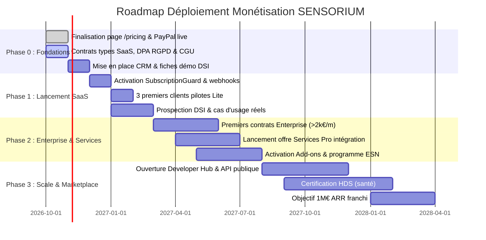

# SENSORIUM — Cahier de Monétisation
**Date :** 25 octobre 2026  
**Auteur :** @Tt  
**Version :** 1.0.0 — Stratégie Commerciale & Pricing B2B  

---

## Résumé Exécutif
**SENSORIUM** est une plateforme SaaS B2B de supervision d'infrastructure physique et numérique (bâtiments intelligents, flotte IoT, conformité DORA / CSRD / ISO 27001) construite en stack souveraine. Le produit est mature (18 pages, 71 composants, 22 routes API, 24 services backend, build 8de7fb7) avec une différenciation technique forte : jumeau numérique 3D, remédiation AIOps < 1,5 s, ingestion IoT > 1,4 M req/s.

Ce positionnement justifie un pricing d'entreprise et des flux de revenus multiples.

### Potentiel ARR Estimé
| Horizon | ARR Bas | ARR Haut |
| :--- | :--- | :--- |
| **Year 1** | 300 000 € | 600 000 € |
| **Year 2** | 1 200 000 € | 2 500 000 € |
| **Year 3** | 4 000 000 € | 8 000 000 € |

**Les trois leviers principaux :**
1. Abonnements SaaS multi-tier (Lite / Pro / Enterprise)
2. Services professionnels et intégration GTB/BMS sur site
3. Marketplace de modules verticaux & connecteurs partenaires

---

## Analyse du Produit et Positionnement Marché
SENSORIUM combine 4 catégories logicielles généralement achetées séparément :
- **CAFM** (Gestion technique des installations & GMAO)
- **UEM** (Gestion unifiée des endpoints IoT & passerelles)
- **SIEM-lite** (Sécurité Zero-Trust & détection d'intrusions)
- **ESG / Conformité** (Décret Tertiaire, Décret BACS, DORA, CSRD)

### Forces
- **Stack souveraine européenne :** Déploiement on-premise, cloud privé ou SecNumCloud (exempt du CLOUD Act américain, conformité NIS2).
- **Jumeau numérique 3D (Three.js) :** Modélisation spatiale vectorielle et thermique en temps réel.
- **Haute vélocité industrielle :** Ingestion IoT à 1,4 M req/s avec latence Edge P99 < 1 ms.
- **Conformité réglementaire native :** Rapports opposables DORA / CSRD / ISO 27001 générés en 1 clic.
- **Architecture multi-tenant RBAC :** Prête pour la revente en marque blanche (OEM / Intégrateurs).
- **Scénario démo DSI chiffré :** ROI moyen de 18 400 €/an par bâtiment dès le 1er trimestre.

### Faiblesses & Risques Identifiés
- Positionnement très large à segmenter commercialement selon les personas.
- Dépendance résiduelle aux SDK cloud pour l'auth initiale (transition on-premise/SAML requise pour les banques/défense).
- Écosystème partenaires encore en phase de constitution.

### Marché Adressable (Europe)
| Segment | TAM Europe | SAM Réaliste (3 ans) |
| :--- | :--- | :--- |
| **Smart Building / CAFM** | 4,2 Md€ | 80 M€ |
| **UEM B2B** | 2,8 Md€ | 40 M€ |
| **Conformité DORA / CSRD** | 1,9 Md€ | 35 M€ |
| **IoT Industriel OT** | 6,1 Md€ | 60 M€ |

---

## Segments Cibles et Personas

### Segment 1 — Grands Comptes (ETI / GE, > 500 salariés)
- **Cible prioritaire (★★★)**
- **Décideur :** DSI, Directeur Immobilier / Facility Management, Directeur RSE.
- **Budget moyen :** 40 000 € à 150 000 €/an.
- **Cycle de vente :** 6 à 12 mois.
- **Besoins :** Conformité DORA/NIS2 obligatoire, réduction de charges énergétiques (-34,8 %), supervision multi-sites.

### Segment 2 — Secteur Public et Santé
- **Cible à forte valeur (★★)**
- **Décideur :** DSI CHU, Direction des Systèmes d'Information Régionaux.
- **Ticket moyen :** 80 000 €/an (contrats pluriannuels 3 à 5 ans).
- **Contrainte :** Hébergement HDS, souveraineté stricte, zéro cloud US.

### Segment 3 — PME Tech & Scale-ups (50 à 500 salariés)
- **Adoption rapide (★★★)**
- **Ticket moyen :** 5 000 €/an.
- **Cycle de vente :** 1 à 3 mois (self-service / inbound).

### Segment 4 — Intégrateurs et ESN (Channel Partenaires)
- **Multiplicateur de croissance (★★★)**
- **Modèle :** Licence OEM ou commission d'apporteur 20 à 30 %.

---

## Modèles de Monétisation Recommandés

### 1. Grille d'Abonnements SaaS Multi-Tier

| Paramètre | **Tier Lite** | **Tier Pro (Recommandé)** | **Tier Enterprise** |
| :--- | :--- | :--- | :--- |
| **Prix Mensuel** | **149 € / mois** | **699 € / mois** | **Sur devis (dès 2 500 €)** |
| **Prix Annuel (-20%)** | **119 € / mois** | **559 € / mois** | **Sur devis annuel** |
| **Périmètre Bâtiments** | 1 bâtiment (1 tenant) | Jusqu'à 10 bâtiments (3 tenants) | Multi-tenant illimité |
| **Utilisateurs inclus** | 5 sièges | 25 sièges | Sièges illimités |
| **Jumeau 3D** | Plans 2D interactifs | Jumeau 3D Three.js complet | BIM IFC 4.3 + Jumeau immersif |
| **Conformité & ESG** | Tableaux de bord de base | Audit DORA + Export CSRD | Certification continue DORA/CSRD |
| **SLA & Support** | Support standard 48h | Support prioritaire 12h | Support dédié 24/7 / SLA 99,99% |
| **Déploiement** | Cloud mutualisé | Cloud souverain UE | On-Premise / SecNumCloud / HDS |

### 2. Modules Complémentaires (Add-ons Pay-per-Feature)
- **Module Conformité CSRD :** +150 € / mois (Audit carbone temps réel, exports ADEME OPERAT)
- **Module Jumeau 3D Avancé :** +200 € / mois (Rendu WebGL 60 FPS, calques thermiques dynamiques)
- **Module AIOps Prédictif :** +250 € / mois (Moteur d'inférence pannes CVC, détection < 1,5s)
- **Module Sécurité Zero-Trust :** +100 € / mois (Coffre-fort FIPS 140-3, mTLS hardware)
- **Module Terrain Mobile :** +80 € / mois (PWA technicien hors-ligne + scanner QR/NFC)

### 3. Rapports de Conformité Ponctuels (Pay-per-Use)
Pour les prospects non encore abonnés ou nécessitant un livrable réglementaire d'urgence :
- **Bilan CSRD & Taxonomie Européenne :** 699 € / rapport
- **Rapport d'Audit Annuel DORA :** 499 € / rapport
- **Diagnostic Conformité ISO 27001 :** 299 € / rapport

### 4. Services Professionnels & Intégration
- **Pack Déploiement Clé en Main :** 15 000 € forfaitaire (Audit technique, paramétrage jumeau 3D, mise en service)
- **Régie d'Intégration Systèmes (GTB / BACnet / Modbus) :** 1 200 € à 1 800 € / jour homme

---

## Roadmap Commerciale

---

## KPIs de Suivi Stratégique
- **Revenus :** ARR (Objectif Y1 : 300 k€), MRR Net New > 0, Churn < 3%/mois.
- **Conversion :** Ratio Démo DSI → Contrat signé > 20%, Durée de cycle < 45 j (Lite) / < 180 j (Enterprise).
- **Impact Client :** Réduction de charge énergétique mesurée (-34,8 %), temps de remédiation AIOps < 1,5 s, disponibilité SLA 99,99 %.
